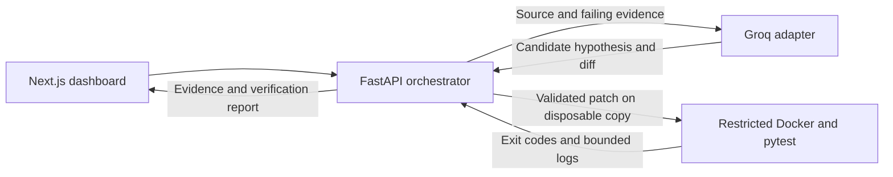

# PatchPilot

AI-powered debugging agent that reproduces bugs in isolated Docker environments,
generates candidate patches using Groq, and verifies fixes through actual test execution.

A full-stack engineering portfolio project with a deliberately bounded scope:
**four reviewed Python fixtures**, not arbitrary GitHub repositories. The dashboard
shows the original failure, source-backed hypothesis, candidate diff, and actual
test evidence behind each verification result.

## Features

- Responsive dark dashboard, live API health and read-only fixture discovery.
- Reproduction-only runs or reproduction → investigation → patch → verification.
- Provider-independent model interface using Groq and validated JSON responses.
- Source references, unified diffs, exit codes, timestamps and bounded stdout/stderr.
- One candidate attempt per run, applied only to a disposable copy.
- Verification requires the original failing test and full regression suite to pass.
- Distinct states for Docker/model errors, rejected patches and failed verification.

## Verified results

| Check | Observed result |
| --- | --- |
| Phase 3 Docker-enabled backend suite | **138 passed, 1 skipped, no warnings** |
| `checkout-empty-cart` | Real Groq-generated patch verified in Docker |
| `shipping-threshold` | Real Groq-generated patch verified in Docker |
| `quantity-bool`, `csv-quoted-fields` | Reproduced and tested in Docker with deterministic **test-only** candidates |
| Browser → backend debugging | Real Groq investigation and Docker verification completed through the dashboard |

The skipped case is a separately opted-in live Groq test. CI requires no provider
key and makes no paid model calls. Recorded results are not a promise that every
model response will be correct; unsuccessful attempts are documented too.

See [Phase 3 verification](docs/phase-3-verification.md),
[browser verification](docs/phase-2-verification.md), and the
[initial AI verification record](docs/mvp-verification.md). Raw local reports are excluded from Git.

## Technology stack

| Layer | Technology |
| --- | --- |
| Frontend | Next.js App Router, React, TypeScript, Tailwind CSS |
| API | Python 3.11/3.12, FastAPI, Pydantic settings |
| AI | Groq API through a provider-independent adapter |
| Execution | Docker, Python 3.12 sandbox image, pytest |
| Quality | pytest/httpx, TypeScript, ESLint, GitHub Actions |

No database, Redis, Celery or authentication is implemented yet.

## Architecture and workflow



1. Select an approved fixture and describe its bug.
2. Copy reviewed files and reproduce the expected failure in Docker.
3. Send actual source and failing evidence to the model, without platform secrets.
4. Validate references and the diff; reject tests, foreign fixtures and out-of-scope paths.
5. Apply the candidate to the disposable copy and rerun the failing test and full suite.
6. Compute verification from real results, then clean up the container and copy.

The original benchmark stays buggy. Model confidence alone cannot verify a patch.

```text
apps/api/                  FastAPI, model adapter, patch validation and tests
apps/web/                  Next.js dashboard and generated API types
services/sandbox-runner/    Docker orchestration and reviewed fixture registry
benchmarks/fixtures/        Deliberately buggy packages, tests and manifests
docs/                      API contract, architecture and verification records
infra/                     Reserved for future infrastructure
.github/workflows/         Backend unit and Docker integration CI
```

## Supported fixtures

| ID | Category | Deliberate bug | Expected baseline |
| --- | --- | --- | --- |
| `checkout-empty-cart` | Edge case | First-item indexing on an empty cart | 1 failed, 3 passed |
| `shipping-threshold` | Business logic | Free shipping excludes exactly 50.00 | 1 failed, 3 passed |
| `quantity-bool` | Input validation | True accepted as an integer quantity | 1 failed, 5 passed |
| `csv-quoted-fields` | Parsing | Naive splitting breaks quoted CSV fields | 1 failed, 3 passed |

The registry is an explicit allowlist. Adding a folder does not authorize execution.
See [adding approved fixtures safely](docs/adding-fixtures.md).

## Installation prerequisites

- Windows PowerShell, Git, Python **3.12** recommended (3.11 also supported).
- Node.js **22 LTS** and npm; the frontend includes `package-lock.json`.
- Docker Desktop running **Linux containers**, with Windows/WSL2 prerequisites enabled.
- A Groq API key for live AI runs. Reproduction and normal tests need no key.
- Internet access for dependency/image installation and live Groq requests.

Start Docker Desktop and confirm `docker version` reports both **Client and Server**.
A working CLI alone is insufficient. Resolve Docker startup failures first;
PatchPilot reports infrastructure errors rather than running fixtures on the host.

## Windows PowerShell setup

For a fresh checkout:

```powershell
git clone https://github.com/AyishathNahda/Patch_Pilot.git
Set-Location Patch_Pilot
py -3.12 -m venv .venv
.\.venv\Scripts\python.exe -m pip install -r apps\api\requirements.txt -e services\sandbox-runner
if (-not (Test-Path apps\api\.env)) { Copy-Item apps\api\.env.example apps\api\.env }
Set-Location apps\web
npm.cmd ci
Set-Location ..\..
docker build --tag patchpilot-sandbox:day2 services\sandbox-runner
```

Use `py -3.11` if needed. Calling the virtual environment's Python directly avoids
activation-policy changes; `npm.cmd` avoids PowerShell restrictions on npm.ps1.
For an existing checkout, start at its root and skip cloning/venv creation when
already present. Do not overwrite an existing `.env` containing your key.

### Environment configuration

Edit ignored `apps/api/.env` locally:

```dotenv
PATCHPILOT_SERVICE_NAME=patchpilot-api
PATCHPILOT_ENVIRONMENT=development
PATCHPILOT_LOG_LEVEL=INFO
GROQ_API_KEY=your_groq_api_key_here
PATCHPILOT_GROQ_MODEL=openai/gpt-oss-20b
PATCHPILOT_CORS_ORIGINS=["http://localhost:3000","http://127.0.0.1:3000"]
```

The value above is a placeholder. Never commit the real key or put it in the
frontend. Environment variables override `.env`. Execution routes exist only in
development mode. Run the API from `apps/api` so its `.env` is loaded.

The optional ignored `apps/web/.env.local` contains only:

```dotenv
NEXT_PUBLIC_API_BASE_URL=http://127.0.0.1:8000
```

That is the default when omitted. Production builds embed this public setting,
so rebuild after changing it. Never use `NEXT_PUBLIC_` for a credential.

### Backend and frontend startup

Terminal 1, from repository root:

```powershell
Set-Location apps\api
..\..\.venv\Scripts\python.exe -m uvicorn app.main:app --host 127.0.0.1 --port 8000
```

Terminal 2, from repository root:

```powershell
Set-Location apps\web
npm.cmd run dev
```

Open [the dashboard](http://127.0.0.1:3000) and [API docs](http://127.0.0.1:8000/docs).
Stop servers with Ctrl+C. For a local production frontend build, run
`npm.cmd run build` then `npm.cmd run start` from `apps/web`.

## API

| Method | Endpoint | Purpose |
| --- | --- | --- |
| GET | `/health` | API liveness; not Docker readiness |
| GET | `/api/v1/fixtures` | Read-only approved fixture metadata |
| POST | `/api/v1/reproductions` | Tests-only execution |
| POST | `/api/v1/debug-runs` | One complete debugging attempt |

Example from another PowerShell window:

```powershell
$body = @{ fixture_id = 'shipping-threshold'; bug_description = 'A subtotal of exactly 50.00 should qualify for free shipping.' } | ConvertTo-Json
Invoke-RestMethod -Method Post -Uri http://127.0.0.1:8000/api/v1/debug-runs -ContentType 'application/json' -Body $body
```

See [API schemas and status handling](docs/api.md). HTTP 200 does not always mean
tests passed; inspect `status`, `verified`, and the returned stage evidence.

## Tests and GitHub Actions CI

Backend, from repository root:

```powershell
.\.venv\Scripts\python.exe -m pip check
.\.venv\Scripts\python.exe -m pytest -q -W error
# Docker Desktop and the sandbox image must be available:
.\.venv\Scripts\python.exe -c "import os,pytest; os.environ['PATCHPILOT_RUN_DOCKER_TESTS']='1'; os.environ['PATCHPILOT_RUN_GROQ_TESTS']='0'; raise SystemExit(pytest.main(['-q','-W','error']))"
```

Default discovery excludes benchmark tests from host execution. Unit tests mock
Docker/model boundaries; Docker-marked tests run real containers. Live Groq tests
require `PATCHPILOT_RUN_GROQ_TESTS=1` as an additional opt-in and may consume quota.

Frontend, from `apps/web`:

```powershell
npm.cmd run typecheck
npm.cmd run lint
npm.cmd run build
```

API types are included in source. After an intentional contract change, start
FastAPI on port 8000 and run `npm.cmd run generate:api` from `apps/web`.

[GitHub Actions](.github/workflows/backend.yml) runs warning-clean unit tests on
Python 3.11/3.12 and real Docker tests on Ubuntu/Python 3.12. It requires no Groq
secret and disables live provider calls.

## Security measures and sandbox isolation

- No fixture/candidate code executes inside the API process; Docker calls use argument lists without a shell.
- Containers have no network, run as UID/GID 65532, drop capabilities and prohibit privilege escalation.
- Read-only root and fixture mounts; bounded temporary storage, CPU, memory, processes, execution time and output.
- No Docker socket, host credentials, unrelated directories or provider key are mounted/injected into containers.
- Only registered source files can be patched; tests, traversal, links and cross-fixture modifications are rejected.
- `.env`, `.data`, virtual environments, dependencies, build outputs, logs and raw local reports are excluded from Git.

Docker is a **limited isolation boundary**, not proof of safe hostile-code execution.
The API controls Docker on its host and is intended for trusted local development.
CORS is not authentication. See [architecture](docs/architecture.md).

## Current limitations and future improvements

- No arbitrary GitHub repository imports or general-purpose execution API.
- No authentication, production deployment, database or persistent run history.
- Synchronous requests: no streaming, polling or fabricated intermediate progress.
- One active execution per API process; results remain only in browser-session memory.
- Model errors and rejected candidates are possible; passing tests establish only the behavior covered by the fixture suite.
- ESLint 9 remains for current Next lint-plugin compatibility; npm reports its upstream deprecation notice.

Future work includes portable frontend test CI, broader reviewed benchmarks,
background jobs with persistence, stronger execution isolation and, after those
boundaries are designed, carefully controlled repository support.
